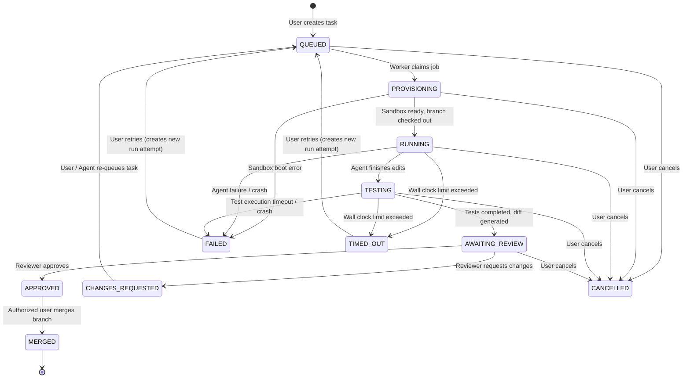
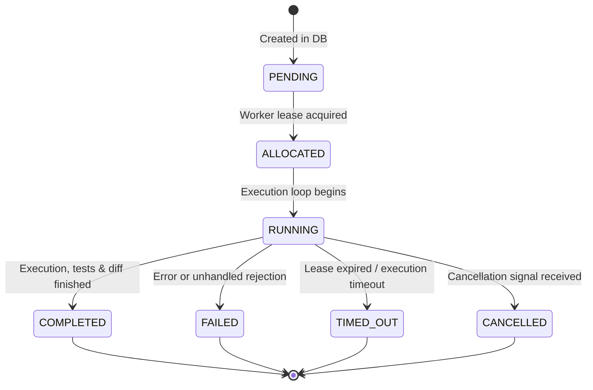
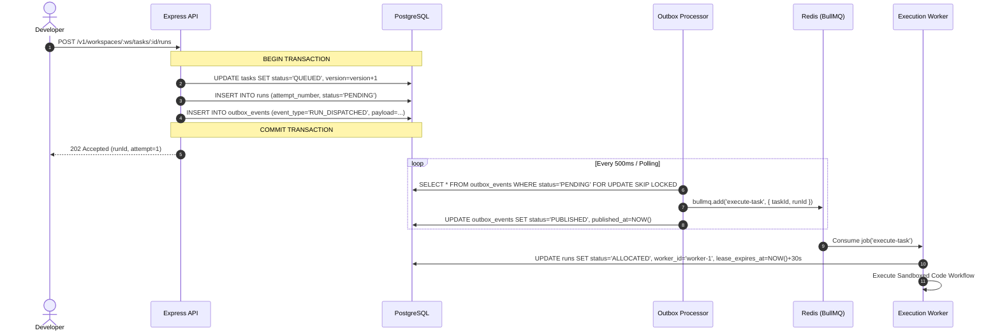

# AgentForge System Architecture

## 1. System Overview

AgentForge is an enterprise-grade, multi-tenant orchestration platform designed to automate software engineering workflows using AI coding agents. Unlike conversational chatbots or basic prompt wrappers, AgentForge executes real code modifications on actual Git repositories within isolated sandbox environments, runs automated test suites, generates unified diffs, tracks granular resource usage, and enforces human-in-the-loop review before any change is merged to a protected branch.

```mermaid
flowchart TD
    subgraph ClientLayer ["Client Layer"]
        Web["Next.js Web Dashboard\n(React 19 / Tailwind / Lucide)"]
    end

    subgraph GatewayControlPlane ["Control Plane (API)"]
        API["Express API Server\n(/v1 REST + WebSocket Server)"]
        AuthMiddleware["Clerk / JWT Auth &\nTenant Scope Middleware"]
        StateEngine["Task & Run State Engine\n(Optimistic Concurrency)"]
    end

    subgraph DataPersistence ["Data & Persistence Layer"]
        PG[("PostgreSQL 16\n(Prisma ORM + RLS)")]
        OutboxTable[("Transactional Outbox")]
        RedisQueue[("Redis 7 + BullMQ\n(Reliable Job Queues)")]
        ObjectStorage[("S3 / MinIO\n(Logs, Diffs, Artifacts)")]
    end

    subgraph WorkerExecutionPlane ["Execution Plane (Workers)"]
        Worker["BullMQ Worker Process"]
        OutboxRelay["Outbox Relay Service"]
        LeaseManager["Worker Lease &\nHeartbeat Manager"]
        AgentEngine["Agent Orchestrator\n(Tool Loop & Budget Guard)"]
        SandboxDriver["Sandbox Abstraction\n(Docker / MicroVM)"]
    end

    subgraph ExternalIntegrations ["External Integrations"]
        GitHub["GitHub App API\n(Repo Access & PRs)"]
        LLM["AI Providers\n(Claude / GPT-4o / Gemini)"]
    end

    %% Client communication
    Web -->|HTTPS REST /v1| API
    Web <-->|WSS Socket.io (Auth Rooms)| API

    %% Control Plane data access
    API --> AuthMiddleware
    AuthMiddleware --> StateEngine
    StateEngine --> PG
    StateEngine --> OutboxTable

    %% Asynchronous Processing
    OutboxTable -.->|Poll & Dispatch| OutboxRelay
    OutboxRelay --> RedisQueue
    RedisQueue --> Worker

    %% Worker Execution
    Worker --> LeaseManager
    LeaseManager --> PG
    Worker --> AgentEngine
    AgentEngine --> LLM
    AgentEngine --> SandboxDriver
    SandboxDriver --> ObjectStorage
    Worker --> GitHub

    %% Real-time event propagation
    Worker -->|Publish Run Events| RedisQueue
    RedisQueue -.->|Redis Pub/Sub| API
    API -.->|Emit to Workspace Room| Web
```

---

## 2. Architectural Principles

1. **Modular Monolith First**: The system is organized as a unified codebase with distinct, decoupled domain packages (`apps/api`, `apps/worker`, `apps/web`, `packages/db`, `packages/shared`, `packages/agent-adapters`, `packages/sandbox`). This ensures fast development and strict typing while enabling independent runtime scaling of the API and execution workers.
2. **PostgreSQL as Single Source of Truth**: All durable application state (workspaces, memberships, tasks, run records, audit logs, approvals) resides in PostgreSQL. BullMQ is used purely for ephemeral job transport and scheduling.
3. **Zero Host Execution**: Generated code is **never** executed inside the API process or worker host. Code execution occurs exclusively inside isolated sandbox containers or microVMs with restricted capabilities and zero host socket access.
4. **Transactional Outbox Pattern**: Job dispatch and event notifications are recorded in a PostgreSQL `outbox_events` table within the same transaction as the task state mutation. An outbox processor reliably forwards events to Redis/BullMQ, preventing split-brain states caused by network drops between Postgres and Redis.
5. **Idempotency & Lease Recovery**: All worker operations are designed for at-least-once delivery. Each run attempt has a unique attempt number, worker lease expiration, and periodic heartbeats. Stale or crashed runs are automatically detected and transitioned cleanly.
6. **Strict Multi-Tenancy**: Every database query is tenant-scoped by `workspace_id`. Cross-tenant record access is blocked at the database, service, queue, and WebSocket layers.
7. **Human-in-the-Loop Governance**: Agent Forge strictly forbids automatic merging into protected branches. All proposed code modifications generate reviewable diffs and test logs requiring explicit human approval.

---

## 3. Component Details & Interactions

### 3.1 Control Plane (`apps/api`)

- **Technology**: Node.js, Express, TypeScript, Zod.
- **Role**: Handles HTTP requests, webhook ingestion, tenant authorization, task lifecycle transitions, diff retrieval, approval recording, and WebSocket connection upgrades.
- **Request Lifecycle**:
  `HTTP Request` $\to$ `Request Correlation ID Middleware` $\to$ `Authentication (Clerk/JWT)` $\to$ `Tenant Context Extraction` $\to$ `Zod Schema Validation` $\to$ `RBAC Authorization Policy Check` $\to$ `Domain Service Layer` $\to$ `Prisma Transaction (State + Outbox)` $\to$ `HTTP Response`.

### 3.2 Asynchronous Job Processor (`apps/worker`)

- **Technology**: Node.js, BullMQ, TypeScript.
- **Role**: Long-running background daemon responsible for:
  - Picking up queued tasks.
  - Acquiring distributed execution leases in PostgreSQL.
  - Requesting an isolated sandbox instance.
  - Cloning repository code via short-lived GitHub App tokens into dedicated task branches (`agentforge/task-{taskId}-{timestamp}`).
  - Running the AI agent loop (prompting, tool calls, file edits, command execution).
  - Executing test suites inside the sandbox.
  - Collecting execution logs, diffs, and resource metrics.
  - Storing artifacts in S3/MinIO and recording final run status.
- **Graceful Shutdown**: Listens to `SIGTERM` / `SIGINT`. Pauses BullMQ queue ingestion, finishes active sandbox cleanup where possible, and marks in-flight runs with appropriate lease metadata for failover recovery.

### 3.3 Real-Time WebSocket Gateway

- **Technology**: Socket.io backed by Redis Pub/Sub Adapter.
- **Role**: Broadcasts real-time execution logs, tool invocation events, test progress, and task status changes to authenticated browser clients.
- **Security & Authorization**: Clients pass a valid JWT during the WebSocket handshake. Subscriptions are authorized strictly per-workspace (`room: workspace:{workspaceId}`). A user cannot subscribe to another tenant's task events.
- **Recovery & Monotonicity**: Every `run_event` carries a monotonically increasing `sequence_number`. Clients reconnecting after network interruption query `/v1/workspaces/:workspaceId/tasks/:taskId/runs/:runId/events?sinceSeq=N` to backfill missed events without gaps or duplicates.

---

## 4. Logical Task vs. Execution Run State Machines

To ensure complete observability and auditability, AgentForge strictly separates **Logical Task State** (the overarching business entity) from **Execution Run State** (each execution attempt). Retries or revision requests create a new `run` record rather than overwriting history.

### 4.1 Task State Machine



#### Task Transition Rules:

1. `QUEUED`: Initial state upon creation or re-queueing.
2. `PROVISIONING`: Worker has locked the task and is provisioning the sandbox and Git branch.
3. `RUNNING`: AI Agent is actively reasoning, reading files, and writing code.
4. `TESTING`: Code changes are saved; automated test suite is running inside the sandbox.
5. `AWAITING_REVIEW`: Execution succeeded, tests evaluated, unified diff produced. Awaiting human decision.
6. `APPROVED`: Reviewer with `REVIEWER`, `ADMIN`, or `OWNER` role accepted the changes.
7. `CHANGES_REQUESTED`: Reviewer requested revisions. Task can be re-prompted.
8. `MERGED`: Terminal success state. Changes merged to the target repository branch.
9. `FAILED`: Run encountered an unrecoverable failure (e.g. fatal syntax error, sandbox crash, unhandled exception).
10. `CANCELLED`: Explicitly halted by an authorized user.
11. `TIMED_OUT`: Maximum task duration exceeded (guarded by workspace execution budget).

### 4.2 Run State Machine (Per Attempt)



---

## 5. Transactional Outbox & Reliable Dispatch

When a task mutation occurs (e.g., Task Created, Run Triggered, Task Cancelled):



---

## 6. Worker Leases, Heartbeats, and Stale Recovery

To prevent zombie runs when workers die ungracefully:

1. **Worker Lease**: When a worker claims a run, it sets `lease_expires_at = NOW() + INTERVAL '30 SECONDS'`.
2. **Heartbeat Daemon**: Active workers run an internal timer every 10 seconds updating `lease_expires_at = NOW() + INTERVAL '30 SECONDS'`.
3. **Stale Run Reaper**: A scheduled cron job queries:
   ```sql
   SELECT id, task_id FROM runs
   WHERE status IN ('ALLOCATED', 'RUNNING')
     AND lease_expires_at < NOW() - INTERVAL '15 SECONDS';
   ```
   If a run's lease has expired without renewal, the reaper marks the run as `FAILED` (with reason `WORKER_HEARTBEAT_TIMEOUT`), cleans up orphaned resources, and either marks the task `FAILED` or triggers an automatic retry if `attempt_number < max_retries`.
