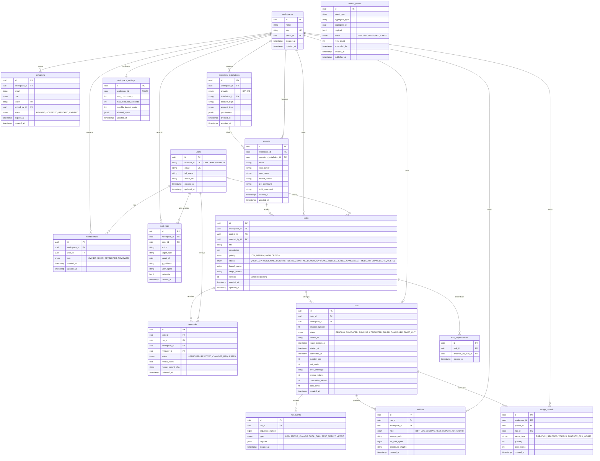

# AgentForge Entity Relationship Diagram & Database Schema

## 1. Entity Relationship Diagram (Mermaid)



---

## 2. Table Specifications & Constraints

### 2.1 Identifiers Strategy

All primary keys use UUIDs (UUIDv7 or UUIDv4). UUIDs prevent enumeration attacks (IDOR) and avoid auto-increment collisions across distributed nodes.

### 2.2 Core Constraints & Indexes

#### `workspaces`

- `slug` is UNIQUE.
- Index on `owner_id`.

#### `memberships`

- Unique constraint: `UNIQUE (workspace_id, user_id)`. Ensures a user cannot hold multiple roles simultaneously within the same workspace.
- Index: `INDEX idx_memberships_user (user_id)` for listing workspaces for a user.
- Index: `INDEX idx_memberships_workspace (workspace_id)` for member lookups.

#### `tasks`

- Compound Index: `INDEX idx_tasks_tenant_project (workspace_id, project_id, status)`. Optimizes Kanban board and project task queries.
- Compound Index: `INDEX idx_tasks_tenant_created (workspace_id, created_at DESC)`. Optimizes paginated task feeds.
- Optimistic Concurrency Control: `version INT NOT NULL DEFAULT 1`. Every mutation increments `version`. If the client submits a stale version, the transaction aborts with a concurrency conflict.

#### `task_dependencies`

- Unique constraint: `UNIQUE (task_id, depends_on_task_id)`.
- Check constraint: `CHECK (task_id <> depends_on_task_id)`. Prevents self-dependency.
- Cycle validation: Enforced at the application service layer via Tarjan's / Depth-First-Search cycle detection before committing.

#### `runs`

- Unique constraint: `UNIQUE (task_id, attempt_number)`. Ensures attempt numbers are strictly sequential and non-duplicative per task.
- Compound Index: `INDEX idx_runs_lease (status, lease_expires_at)`. Crucial for high-performance stale-run reaper queries.
- Compound Index: `INDEX idx_runs_tenant_task (workspace_id, task_id, attempt_number DESC)`.

#### `run_events`

- Unique constraint: `UNIQUE (run_id, sequence_number)`. Guarantees strict monotonicity and eliminates duplicate event processing.
- Index: `INDEX idx_run_events_seq (run_id, sequence_number ASC)`. Accelerates client log streaming and reconnection backfills.

#### `artifacts`

- Index: `INDEX idx_artifacts_run (run_id, type)`.

#### `outbox_events`

- Index: `INDEX idx_outbox_pending (status, scheduled_for, created_at) WHERE status = 'PENDING'`. Partial index ensuring the outbox poller only scans uncommitted/pending messages with zero table-scan overhead.

#### `audit_logs`

- Index: `INDEX idx_audit_tenant_time (workspace_id, created_at DESC)`. Fast audit trail queries.

---

## 3. Row-Level Security (RLS) Defense-in-Depth

In addition to API application-layer authorization checks, PostgreSQL Row-Level Security policies are applied as a defense-in-depth safeguard against SQL injection or buggy queries:

```sql
-- Enable RLS on tenant-owned tables
ALTER TABLE tasks ENABLE ROW LEVEL SECURITY;
ALTER TABLE runs ENABLE ROW LEVEL SECURITY;
ALTER TABLE artifacts ENABLE ROW LEVEL SECURITY;
ALTER TABLE audit_logs ENABLE ROW LEVEL SECURITY;

-- Transaction-scoped workspace variable policy:
CREATE POLICY tenant_isolation_policy ON tasks
    FOR ALL
    USING (workspace_id = NULLIF(current_setting('app.current_workspace_id', true), '')::uuid);
```

During each API request or worker job execution, the database session sets `SET LOCAL app.current_workspace_id = '<workspace_id>'` inside the transaction boundary.
