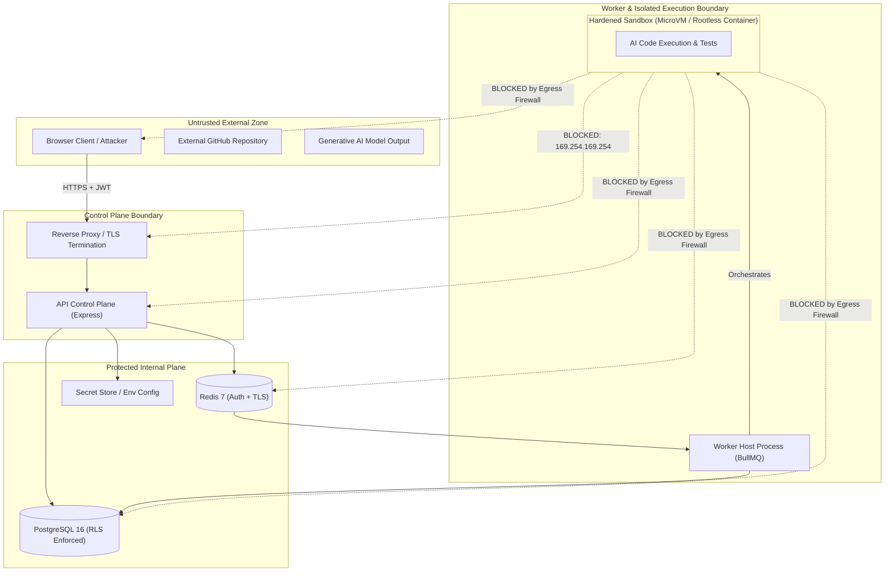

# AgentForge Threat Model & Security Architecture

## 1. Executive Summary & Philosophy

AgentForge executes autonomous AI coding agents on untrusted third-party code repositories. This architecture presents critical security challenges: the platform runs arbitrary, dynamic code generated by generative models and cloned from external repositories.

**Core Tenet**: _Neither repository contents, nor developer prompts, nor AI-generated code, nor the execution sandbox can ever be trusted._

Every system boundary must defend itself under the assumption that the adjacent layer has been actively compromised.

---

## 2. Trust Boundaries & Data Flow

---

## 3. STRIDE Threat Analysis & Mitigations

### 3.1 Spoofing (Identity & Tenant Spoofing)

- **Threat**: An attacker passes a forged JWT or attempts to impersonate another user or workspace member.
- **Mitigation**:
  - Managed authentication (Clerk) validates cryptographic JWT signatures with public keys and short expirations.
  - Every API endpoint requires an explicit `workspace_id` header or URL parameter. The authorization middleware checks PostgreSQL `memberships` for the verified `user_id` before processing the request.
  - WebSocket handshakes require valid bearer tokens and only allow joining rooms corresponding to verified workspace memberships.

### 3.2 Tampering (Code & Data Integrity)

- **Threat**: An agent or untrusted script modifies system files or tampers with test results or diffs to disguise malicious payload delivery.
- **Mitigation**:
  - Diffs are captured by the Worker host using Git commands directly against the worktree, not reported by the agent itself.
  - Test exit codes and stdout/stderr are captured through supervised execution runners inside the sandbox.
  - Artifacts stored in S3/MinIO include SHA-256 integrity checksums computed prior to storage.
  - Database records use optimistic concurrency control (`version` integer) to reject race conditions and interleaved tampering.

### 3.3 Repudiation (Audit Trail)

- **Threat**: A rogue workspace admin or developer approves malicious code or alters security settings and denies doing so.
- **Mitigation**:
  - Every administrative mutation (invitations, role changes, project settings, branch merges, task cancellations) writes an immutable record to the `audit_logs` table.
  - Audit logs record: `actor_id`, `workspace_id`, `action`, `target_type`, `target_id`, `ip_address`, `user_agent`, and a `metadata` JSON snapshot.
  - Audit records cannot be updated or deleted via the standard API.

### 3.4 Information Disclosure (Cross-Tenant Leakage & Credential Theft)

- **Threat 1**: Cross-tenant data exposure (Insecure Direct Object Reference - IDOR).
  - _Mitigation_: All queries in repositories and services enforce `WHERE workspace_id = :workspaceId`. PostgreSQL Row-Level Security (RLS) is applied as defense-in-depth.
- **Threat 2**: Credential exposure via agent command execution or sandbox environment variables.
  - _Mitigation_: The sandbox environment **never** receives database credentials, Redis URLs, Clerk secret keys, or long-lived GitHub App private keys. Git clone and push operations use ephemeral, short-lived tokens (scoped to a single repository, expiring in 1 hour) that are revoked or omitted from the sandbox process environment.
- **Threat 3**: Secrets leakage in log outputs.
  - _Mitigation_: An automated log redaction filter sanitizes sensitive patterns (API keys, GitHub tokens, Bearer strings) before run events are emitted via WebSockets or written to the database.

### 3.5 Denial of Service (Resource Starvation)

- **Threat**: A user or malicious repo executes fork bombs (`:(){ :|:& };:`), infinite loops (`while(true){}`), or attempts to allocate 100GB of RAM/disk.
- **Mitigation**:
  - **Linux Cgroups & Limits**:
    - CPU limit: strictly capped (e.g., 2 cores max).
    - Memory limit: strictly capped (e.g., 2GB max with swap disabled).
    - PID limit: capped (`--pids-limit 100`) to completely neutralize fork bombs.
    - Disk quota: execution directory capped at 5GB; ephemeral storage mounted on `tmpfs`.
  - **Execution Timeouts**: Strict wall-clock timeout (e.g. 10 minutes maximum per run). If exceeded, the worker forcibly terminates the sandbox and reclaims resources.
  - **Concurrency Quotas**: Per-workspace limits (e.g., maximum 2 concurrent runs per tenant). Excess tasks remain queued in BullMQ.

### 3.6 Elevation of Privilege (Sandbox Breakout & SSRF)

- **Threat 1: Container / Sandbox Breakout**: Untrusted code exploits a kernel or container runtime vulnerability to gain root access to the worker host.
  - _Mitigation_:
    - **Never mount the Docker socket (`/var/run/docker.sock`)** into any execution container.
    - Run the sandbox container as an unprivileged, non-root user (`UID 1000:GID 1000`).
    - Drop all unnecessary Linux capabilities (`--cap-drop ALL`, adding back only essential capabilities like `CHOWN` if required).
    - Use strict `seccomp` profiles and read-only root filesystems (`--read-only`), mounting only a designated `/workspace` and `/tmp` as temporary writable volumes.
    - In production, transition from container-based isolation to **MicroVM isolation** (Firecracker / E2B Sandbox) where each task runs in a separate hardware-virtualized kernel.
- **Threat 2: Server-Side Request Forgery (SSRF) to Cloud Metadata & Internal Services**: Untrusted code requests `http://169.254.169.254/latest/meta-data/` to harvest cloud instance IAM roles, or scans internal subnets (`10.0.0.0/8`, `172.16.0.0/12`, `192.168.0.0/16`) to exploit PostgreSQL (5432) or Redis (6379).
  - _Mitigation_:
    - Sandbox network egress is strictly filtered using host `iptables` / `nftables` or container network policies.
    - Outbound connections to `169.254.169.254/32` (AWS/GCP/Azure metadata) and RFC1918 private subnets are blocked.
    - Only authorized external outbound traffic (e.g., standard package managers like `registry.npmjs.org`, `pypi.org`, `github.com`) is permitted if network access is required, or network access is disabled entirely (`--network none`) for zero-egress workloads.

---

## 4. Prompt Injection & AI Tool Calling Guardrails

1. **Untrusted Instructions vs System Prompt**: Repository contents (e.g., `README.md`, issues, comments) and user instructions are treated as untrusted text. System prompts clearly delineate the boundary between operator instructions and repo context.
2. **Deterministic Tool Schema Validation**: Tool calls generated by the LLM are validated against strict Zod schemas before invocation. The model cannot invoke arbitrary system commands outside the defined `readFile`, `writeFile`, `listFiles`, and `runSandboxCommand` primitives.
3. **Command Sanitization**: `runSandboxCommand` passes command arguments as an array to `execFile` or isolated sandbox API rather than invoking an unescaped shell (`sh -c "$USER_INPUT"`), preventing command injection.
